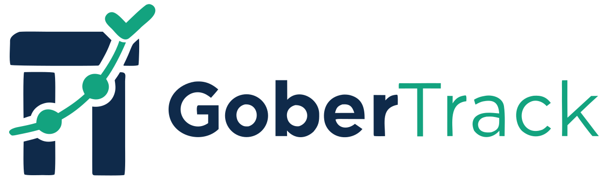

# GoberTrack



Antes llamado *Obra Pública Verificable*.

Ideathon NEA Tech 2026 · vertical Stellar. El pago de cada hito de una obra pública queda retenido en un contrato Soroban. Solo se libera con la aprobación del inspector y del veedor, después del período de objeción y sin objeción abierta. Todo queda registrado en la cadena y un tablero público lo muestra en vivo.

- Especificación (PRD v3): [docs/PRD.md](docs/PRD.md)
- Decisiones tomadas durante la construcción: [docs/registro-ejecucion.md](docs/registro-ejecucion.md)
- Interfaces congeladas: [interfaces/contract.md](interfaces/contract.md) (v1.1) · [interfaces/openapi.yaml](interfaces/openapi.yaml) (v1.0.1)

## Estructura

| Carpeta | Qué hay |
| --- | --- |
| `contracts/` | Contrato Rust/Soroban (`src/`), 156 pruebas unitarias, pruebas de ataque (`tests/ataque.rs`), scripts de testnet y `DEPLOY.md` |
| `backend/` | TypeScript + Fastify + SQLite: API REST de lectura, evidencia con SHA-256 e indexador contra testnet |
| `frontend/` | Next.js: tablero público y panel de firmantes con Freighter |
| `interfaces/` | Acuerdo entre las tres capas |

## Red de la demo (testnet)

| Dato | Valor |
| --- | --- |
| Contrato | `CCRFFXP25OT5FOI3VJXAX666QI76YWHV52IYTG45ICK4TMB7QFS7KYSM` |
| Token de prueba (SAC USDCDEMO, DATO SIMULADO) | `CAKGWGZQI6XOF6XAP2BB2DM6DQP525ETKYDT5UHSYBF2XRA6JUITA2QK` |
| RPC | `https://soroban-testnet.stellar.org` |
| Obra limpia para probar | **obra 4**, "Pavimentación calle Los Aromos": fondeada, 4 hitos `Pendiente`, período de 60 s. Las obras 1–3 ya se usaron en pruebas |

## Correr la demo

Requisitos: Node ≥ 22.18. Para el contrato y los scripts, además: Rust ≥ 1.91 con el target `wasm32v1-none` y Stellar CLI 28.1.0.

```bash
# 1. Backend en modo testnet (http://localhost:3001)
cd backend && npm install && npm run dev:testnet

# 2. Frontend (http://localhost:3000)
cd frontend && npm install
cp .env.testnet.example .env.local     # en Windows: copy
npm run dev
```

- **Firmar desde el navegador:** instalá Freighter, elegí la red Testnet e importá las claves de los roles: municipio (también árbitro), contratista, inspector y veedor.
- **Demo automática sin wallet:** `cd frontend && cp .env.testnet.example .env.testnet && npm run demo:testnet`. Corre el guion completo en testnet: camino feliz, trampa y objeción.
- **Modo simulado, sin red:** en el backend `npm run seed && npm run dev`, y en el frontend `npm run dev` sin `.env.local`.

### Claves de las cuentas de la demo

Las identidades se crearon con `contracts/scripts/setup-testnet.sh` y viven en el almacén de la Stellar CLI de la máquina que las generó (`~/.config/stellar/identity/`, o `%USERPROFILE%\.config\stellar\identity\` en Windows). **No están en el repo y no deben subirse.** Para usarlas en otra máquina, copiá esos archivos a mano. Si no, correr el script ahí crea otras cuentas y otro token, que no son roles de las obras ya creadas.

## Pruebas

```bash
cd contracts && cargo test        # 156 + 10 de ataque (en Windows con host GNU usa .cargo/config.toml)
cd backend   && npm test          # 155
cd frontend  && npm test && npm run build   # 670
```

## Limitaciones del MVP

Ver PRD §17: el árbitro es el municipio; un veedor o inspector que no actúa traba el pago; no hay devolución de fondos; el token tiene que ser un SAC; el período de objeción de 1 minuto es simulado; los pagos son de un token de prueba en testnet.
