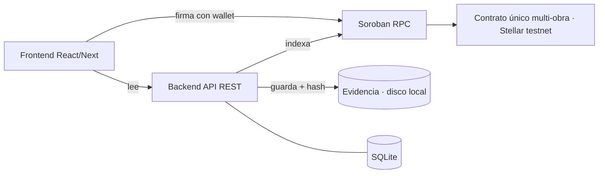
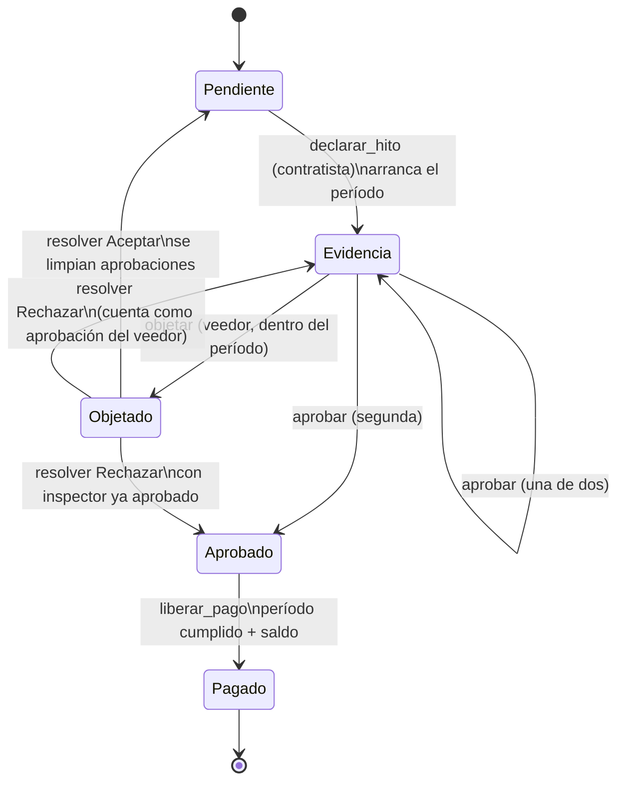

# Obra Pública Verificable — Especificación general (v3)

Ideathon NEA Tech 2026 · Vertical **Stellar** · PRD base para Traycer y los agentes de código. Lo no verificado va marcado **SUPUESTO** o **DATO SIMULADO**.

Proyecto independiente: no comparte contexto ni artefactos con otros planes de este espacio de trabajo. Repositorio: `Z:\obra-publica-verificable`.

Artefactos relacionados:

- Revisión que originó la v3: [Revisión v2 — huecos a cerrar antes de la Fase 0](revision-v2)
- Preparación de la Fase 0: [Fase 0 — entorno, repo e interfaces](fase-0)
- Interfaces congeladas el 16/10/2026: `interfaces/contract.md` v1.0 e `interfaces/openapi.yaml` v1.0.0 en el repo. `contract.md` pasó a v1.1 tras la [revisión del contrato](revision-contrato): son aclaraciones, sin cambios de interfaz.

### Cambios v2 → v3

| # | Tema | Decisión |
| --- | --- | --- |
| 1 | Objeción | El período arranca en `declarar_hito`. Inspector solo aprueba. El veedor decide **una vez**: aprobar u objetar, solo durante el período. Pago = dos aprobaciones + período cumplido + sin objeción abierta. |
| 2 | Fondeo | `fondear(obra, monto)` acumulable, con tope en el total vigente. `liberar_pago` exige saldo suficiente. |
| 3 | Resolución | `resolver_objecion(obra, hito, decision)` por el rol **árbitro** (definido al crear la obra; en el MVP, la dirección del municipio). Aceptar → hito a `Pendiente`, se limpian las aprobaciones, se re-declara con evidencia nueva. Rechazar → la objeción se cierra y **cuenta como aprobación del veedor**; el veedor no puede volver a objetar en esa declaración. |
| 4 | Adendas | El contrato guarda `monto_original` (inmutable) y `monto_vigente`. Adendas siguen fuera del MVP, pero el modelo las soporta. |
| 5 | Despliegue | Un solo contrato con muchas obras indexadas por id. |
| 6 | Errores | Catálogo cerrado de 15 errores (ver §8). |
| 7 | Cola FIFO | Fuera del MVP; pasa a visión futura (solo pitch). |
| 8 | Orden | `declarar_hito(N+1)` falla si N no está `Aprobado` o `Pagado`. |
| 9 | Re-declaración | Cada declaración abre un período nuevo con una objeción disponible. |
| 10 | Roles | Contratista, inspector, veedor y árbitro distintos entre sí; el municipio distinto de contratista, inspector y veedor (puede coincidir con el árbitro). |
| 11 | Menores | Script de trustline en Fase 0 · pruebas de ataque en `contracts/tests/ataque.rs` · nombres de eventos cortos, confirmados contra el SDK vigente. |

Las decisiones 8–10 cierran los huecos detectados al aplicar las decisiones 1–7.

## 1. Resumen

**Idea:** el pago de una obra pública no puede salir sin una aprobación pública, independiente y verificable de cada hito. La cadena registra la aprobación, el orden de pago y todo cambio; nadie puede editarlo después.

**Frase del problema:** "Una oficina de obras honesta necesita demostrar que cada pago respondió a un avance real, porque hoy nadie fuera del circuito puede verificarlo." — **SUPUESTO**, sin validar con un usuario real.

**Mensaje:** "trazabilidad y confianza" para quien adopta; "anticorrupción" para jurado y ciudadanía.

## 2. Alcance

|  | Contenido |
| --- | --- |
| **Entra (MVP)** | Obra con 4 hitos y fondos bloqueados por obra en un contrato Soroban · aprobación de cada hito por inspector **y** veedor · período de objeción desde la declaración · resolución de objeciones por un árbitro · bloqueo de orden (no se declara, aprueba ni paga N+1 sin N aprobado) · backend mínimo (indexa eventos, recibe evidencia y calcula hash, API de lectura) · tablero público de solo lectura + panel de firmantes con wallet |
| **Si hay tiempo (en orden)** | 1. Adendas (monto/plazo con autor, fecha, justificación; el modelo ya guarda monto original y vigente) + alerta de sobrecosto > X% en backend · 2. Geolocalización real de la evidencia |
| **Visión futura (solo pitch)** | Cola de pagos FIFO entre obras con fondos compartidos. Dentro de una obra los hitos son secuenciales y los fondos están bloqueados por obra, así que la cola no aporta en el MVP. |
| **No entra** | Licitaciones, calidad de materiales, identidad real de firmantes, integración con sistemas del Estado, universidades · pago real en cripto por el Estado (el desembolso real sigue en pesos fuera de la cadena; en la demo el "pago" es un token de prueba en testnet) |

## 3. Actores

| Rol | Qué hace | Wallet |
| --- | --- | --- |
| Municipio | Crea la obra y la fondea | Sí |
| Contratista | Declara hito terminado (con hash de evidencia) y cobra | Sí |
| Inspector | Aprueba el hito | Sí |
| Veedor independiente | Decide una vez por declaración: aprueba **u** objeta | Sí |
| Árbitro | Resuelve objeciones (aceptar o rechazar). En el MVP es la dirección del municipio — **limitación a declarar en el pitch** | Sí |
| Ciudadano | Solo mira el tablero | No |

## 4. Flujo de la demo (≈3 min)

1. **Tablero público:** obra, presupuesto, 4 hitos, saldo bloqueado.
2. **Camino feliz:** contratista sube foto → backend calcula hash → contratista declara hito 1 con ese hash (arranca el período de objeción, **DATO SIMULADO:** 1 min) → inspector y veedor aprueban → se cumple el período → se libera el pago.
3. **Intento de trampa:** contratista intenta declarar o cobrar el hito 3 sin el 2 aprobado → el contrato lo rechaza (`HitoAnteriorPendiente`).
4. **Objeción:** con el hito 2 declarado, el veedor lo objeta durante el período en lugar de aprobarlo → el pago queda congelado y el hito 3 sigue bloqueado.
5. **Cierre (sin demo en vivo):** se menciona en el pitch la cola FIFO entre obras como visión futura y que el árbitro del MVP es el propio municipio.

## 5. Arquitectura

- **Contrato:** reglas de pago y roles. Fuente de verdad. Un solo despliegue maneja todas las obras; el indexador sigue un solo contrato.
- **Backend:** copia consultable de estado y eventos (el RPC conserva eventos solo una ventana limitada), evidencia + hash, alertas. **No firma ni paga nada.**
- **Frontend:** lee del backend; las acciones de firmantes las firma la wallet y van directo a la red.

## 6. Modelo de datos (on-chain)

- **Obra:** id, nombre, municipio, contratista, inspector, veedor, árbitro, token, monto_original (inmutable), monto_vigente, fondeado, pagado, periodo_objecion (s), estado.
- **Hito:** índice, descripcion, monto_original (inmutable), monto_vigente, estado, evidencia_hash, momento_declaracion, aprobó_inspector, aprobó_veedor, veedor_por_arbitro (la aprobación del veedor vino de un rechazo de objeción), objeción_usada (en la declaración actual), motivo_objecion_hash, momento_aprobacion_completa.
- **Estados del hito:** `Pendiente → Evidencia → Aprobado → Pagado`, con `Evidencia → Objetado` y desde `Objetado`: Aceptar → `Pendiente`, Rechazar → `Evidencia` o `Aprobado`.
- **Adenda** *(si hay tiempo)*: obra, hito, monto_anterior, monto_nuevo, autor, hash_justificacion, momento. Modifica `monto_vigente`; `monto_original` nunca cambia.

Montos: enteros con 7 decimales (convención Stellar).

## 7. Interfaz del contrato

Firmas exactas, tipos y orden de validación: `interfaces/contract.md` (v1.1, congelado).

| Función | Quién firma | Nota |
| --- | --- | --- |
| `crear_obra(municipio, nombre, contratista, inspector, veedor, arbitro, token, hitos[(descripcion, monto)], periodo_objecion)` | Municipio | Devuelve el id de la obra |
| `fondear(obra, monto)` | Municipio | Acumulable, tope en el total vigente |
| `declarar_hito(obra, hito, evidencia_hash)` | Contratista | Exige N-1 `Aprobado` o `Pagado`; arranca el período |
| `aprobar(obra, hito, firmante)` | Inspector o veedor | Cada uno una vez por declaración |
| `objetar(obra, hito, motivo_hash)` | Veedor | Solo dentro del período y si todavía no decidió |
| `resolver_objecion(obra, hito, decision)` | Árbitro | `Aceptar` o `Rechazar` |
| `liberar_pago(obra, hito)` | Cualquiera | Solo si se cumplen las reglas |
| `ver_obra(obra)` / `ver_hito(obra, hito)` | Lectura |  |
| `ver_hitos(obra)` / `cantidad_obras()` | Lectura | Agregadas en la Fase 0: el backend reconstruye el estado sin depender de los eventos |
| `registrar_adenda(...)` | — | Si hay tiempo |

## 8. Invariantes del contrato

1. Un hito no se paga sin dos aprobaciones: inspector y veedor. La aprobación del veedor puede venir de un rechazo de objeción por el árbitro.
2. No se declara, aprueba ni paga el hito N+1 si el N no está aprobado o pagado.
3. Contratista, inspector, veedor y árbitro son direcciones distintas entre sí; el municipio es distinto de contratista, inspector y veedor (se valida al crear la obra).
4. La suma de los hitos vigentes es igual al total vigente, y el original nunca cambia. Lo fondeado nunca supera el total vigente y nunca se paga más de lo fondeado.
5. Un hito se paga una sola vez.
6. El veedor decide una vez por declaración (aprobar u objetar). Solo objeta dentro del período. Una objeción abierta congela el hito hasta que el árbitro la resuelva.
7. Cada acción exige la firma de su rol.
8. Todo cambio emite un evento; el historial no se borra (aunque Aceptar limpia las aprobaciones del estado vigente, los eventos anteriores quedan).

**Eventos** (nombres cortos, confirmados contra el SDK vigente en `interfaces/contract.md`): obra creada, obra fondeada, hito declarado, hito aprobado, hito objetado, objeción resuelta, pago liberado (+ adenda r`egistrada`).

**Errores:** `ObraNoExiste`, `HitoNoExiste`, `NoAutorizado`, `RolesDuplicados`, `MontoInvalido`, `ExcedeMontoTotal`, `FondosInsuficientes`, `EstadoInvalido`, `HitoAnteriorPendiente`, `YaDecidio`, `ObjecionAbierta`, `ObjecionYaUsada`, `FueraDePeriodo`, `PeriodoNoCumplido`, `YaPagado`.

## 9. Backend mínimo

- **Stack:** TypeScript + Node, SQLite, SDK JS de Stellar.
- **Indexador:** polling al RPC; guarda eventos y estado en SQLite. El estado (no el historial que el RPC ya descartó) se puede reconstruir leyendo el contrato.
- **API de lectura:** `GET /obras`, `GET /obras/:id`, `GET /obras/:id/hitos`, `GET /obras/:id/eventos`, `GET /obras/:id/alertas` (devuelve lista vacía hasta la Fase 4).
- **Evidencia:** `POST /evidencia` → guarda en disco, devuelve SHA-256 (el que el contratista pasa a `declarar_hito`). Archivos de ejemplo = **DATO SIMULADO**. `GET /evidencia/:sha256` (agregado en la Fase 0) devuelve el archivo para que cualquiera recalcule el hash y lo compare con el de la cadena.
- **Alertas (si hay tiempo):** reglas simples en código (sobrecosto > X% sobre `monto_original`).
- **Contrato de la API:** `interfaces/openapi.yaml` v1.0.0, congelado en la Fase 0.

## 10. Frontend (2 pantallas)

1. **Tablero público:** estado de la obra, hitos, quién aprobó, saldo, línea de tiempo. Lee del backend, sin wallet.
2. **Panel de firmantes:** conectar Freighter, subir evidencia, acciones permitidas según rol (incluido el árbitro), firmar.

Arranca con mocks basados en `interfaces/openapi.yaml`.

## 11. Stack y entorno

- Contrato: Rust + Soroban (versión vigente del SDK). CLI de Stellar; red **testnet**, friendbot.
- Token: activo de prueba tipo USDC en testnet (**DATO SIMULADO**). Las cuentas del **municipio y del contratista** necesitan trustline con el activo; se crea con un script en la Fase 0.
- Backend: TS + Node + SQLite. Frontend: React/Next + SDK JS de Stellar + Freighter.

## 12. Agentes de código

| Agente | Responsabilidad | Dueño de | Cuenta | Modelo | Alternativa |
| --- | --- | --- | --- | --- | --- |
| **A-CONTRATO** | Contrato, pruebas, despliegue testnet, script de trustline | `contracts/` (salvo `contracts/tests/ataque.rs`) | A | Sonnet 5.5 | Opus 5.5 solo para depurar una regla difícil |
| **A-BACKEND** | Indexador, API, evidencia + hash | `backend/` | B | Sonnet 5.5 | — |
| **A-FRONTEND** | Tablero + panel de firmantes | `frontend/` | B | Sonnet 5.5 | Haiku 5.5 para retoques o cuota baja |
| **A-REVISOR** | Revisa el contrato, pruebas de ataque. Solo lectura sobre código ajeno | `contracts/tests/ataque.rs` (lo levanta `cargo test`) | A (sesión nueva) | Opus 5.5 | Sonnet 5.5 si la cuenta no ofrece Opus |

- Opus en plan Pro dentro de Claude Code: **no verificado** (confirmar con `/model`). No usar `opusplan`. Esfuerzo medio por defecto; alto solo para depurar reglas del contrato.
- **Cuotas:** cuenta A = A-CONTRATO y luego A-REVISOR (no a la vez). Cuenta B = A-BACKEND + A-FRONTEND en paralelo (lo que más consume); si se agota, A-FRONTEND pasa a Haiku o espera. Límite por cuenta (ventana 5 h + tope semanal), compartido con el chat. Cada cuenta la usa su titular, sin compartir credenciales.
- **Lanzamiento:** un `git worktree` por agente en su rama (`feat/contract`, `feat/backend`, `feat/frontend`).

## 13. Reglas de coordinación

1. **Interfaces congeladas en Fase 0:** `interfaces/contract.md` (funciones, errores, eventos) e `interfaces/openapi.yaml`. Cambios solo vía Traycer + actualización de este documento.
2. Cada agente edita solo su carpeta; lo demás lo pide.
3. Integración: contrato → backend → frontend. Mocks hasta que el contrato esté desplegado.
4. Una fase por vez por agente; no avanzar con pruebas en rojo.
5. Commits chicos; merge a la rama principal solo tras verificación de Traycer.
6. No inventar funciones del SDK.
7. Si algo no está claro, preguntar.
8. Marcar **SUPUESTO** / **DATO SIMULADO**.

## 14. Fases

| Fase | Quién | Contenido | Aceptación |
| --- | --- | --- | --- |
| 0 | A-CONTRATO + orquestador | Entorno, repo, "hola mundo" en testnet, script de trustline, `interfaces/contract.md` y `interfaces/openapi.yaml`. Único código permitido: el "hola mundo" y el script de trustline | Contrato mínimo desplegado e invocado; trustlines creadas; interfaces aprobadas |
| 1 | A-CONTRATO, A-BACKEND, A-FRONTEND en paralelo | Contrato núcleo (crear, fondear, declarar, aprobar, liberar) · backend con mocks · frontend con mocks | Camino feliz pasa · API responde según contrato · 2 pantallas renderizan |
| 2 | A-CONTRATO, luego A-REVISOR | Objeción y resolución por árbitro, orden de hitos, ataques | Todas las pruebas de §15 pasan |
| 3 | A-BACKEND, A-FRONTEND | Indexador contra testnet, frontend contra backend + wallet | Demo corre de punta a punta |
| 4 | Según cuota | Adendas y alertas | Pruebas nuevas pasan sin romper las anteriores |
| 5 | Todos | Guion, datos de ejemplo, video de respaldo | Demo ensayada 2 veces sin errores |

## 15. Pruebas obligatorias del contrato

- Camino feliz completo de los 4 hitos.
- Cobrar sin las dos aprobaciones → falla.
- Aprobar dos veces con la misma dirección → falla.
- Aprobar con dirección sin rol → falla.
- Saltear un hito → falla.
- Pagar dos veces el mismo hito → falla.
- Objetar fuera del período → falla.
- Pagar con objeción abierta → falla.
- Crear obra con dos roles en la misma dirección → falla.
- Pagar más de lo fondeado → falla.

**Agregadas en v3** (cubren las reglas nuevas):

- Pagar antes de que se cumpla el período, con las dos aprobaciones → falla.
- Declarar el hito N+1 con el N sin aprobar → falla.
- Veedor que aprobó intenta objetar (o que objetó intenta aprobar) → falla.
- Resolver una objeción con una dirección que no es el árbitro → falla.
- Aceptar objeción → el hito vuelve a `Pendiente`, sin aprobaciones; re-declarar abre un período nuevo y el veedor puede objetar otra vez.
- Rechazar objeción → cuenta como aprobación del veedor; el veedor no puede volver a objetar en esa declaración.
- Fondear por encima del total vigente → falla.

## 16. Riesgos y línea de corte

- **Cuota con agentes en paralelo** (riesgo principal): escalonar arranque en cuenta B.
- **Deriva de interfaz:** mitigada con las interfaces de §13.
- **Conflictos de código:** worktrees + carpetas separadas.
- **TTL del almacenamiento Soroban:** probar temprano.
- **Firma con wallet:** lo que más confunde al principio.
- **Equipo sin Rust:** alguien debe poder leer y explicar el contrato.
- **Línea de corte:** si la Fase 3 no anda, demo con contrato por CLI + tablero con datos reales de testnet. Adendas y alertas se descartan primero.

## 17. Supuestos y datos simulados

- Obra "Pavimentación calle Los Aromos" y montos — **DATO SIMULADO**.
- Período de objeción de 1 min — **DATO SIMULADO**.
- Evidencia de ejemplo sin geolocalización — **DATO SIMULADO**.
- Que una oficina de obras adoptaría el flujo — **SUPUESTO**.
- Desembolso real en pesos fuera de la cadena — **SUPUESTO** de diseño.
- Árbitro = municipio en el MVP — limitación de diseño, se declara en el pitch (un árbitro real debería ser independiente del municipio).
- Un veedor que nunca decide traba el pago del hito — limitación del MVP, se declara en el pitch.
- No hay devolución de fondos: una obra fondeada queda bloqueada si el contratista abandona o si inspector o árbitro no actúan (por ejemplo, tras un Rechazar sin aprobación del inspector) — limitación del MVP, se declara en el pitch.
- El token de cada obra tiene que ser un Stellar Asset Contract (o un token sin comisión); el contrato no lo verifica y el tablero destaca las obras que no usan el SAC oficial — limitación del MVP (`contract.md` v1.1 §0).
- Acceso a modelos por plan y modelos internos de Traycer — **SUPUESTO**.
